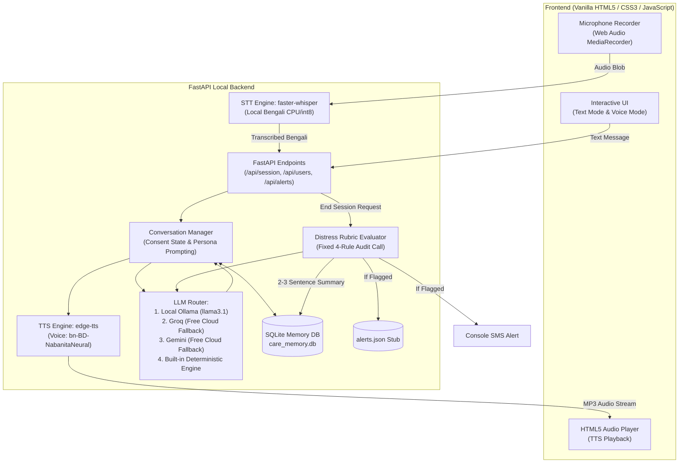

# "Are You Okay?" (আর ইউ ওকে?) — AI Family Care Layer

> **A local, zero-cost MVP prototype for a Bangladeshi AI-for-social-good initiative.**  
> An empathetic Bengali voice companion that regularly checks in on elderly parents whose adult children have migrated abroad for work, detects signs of loneliness/distress using a strict rule-based rubric, and alerts family members.

[](https://fastapi.tiangolo.com/)
[](https://github.com/SYSTRAN/faster-whisper)
[](https://github.com/rany2/edge-tts)
[](#)
[](https://python.org)

---

## 🌟 Core Highlights

1. **Consent as a First-Class Feature**:
   - The AI **never assumes consent**.
   - On the very first session, the AI introduces itself in respectful Bangla, explains what it is, what memory it keeps, who sees wellbeing signals, and **explicitly requires consent** before any check-in proceeds.
   - If declined, the companion politely ends the session and records the user as inactive.
2. **Contextual Memory (Never Full Transcripts)**:
   - Stores only a concise, running **2–3 sentence summary** of prior sessions in a local SQLite database.
   - Later sessions naturally reference prior topics (e.g. *"Last time you mentioned your knee was hurting and you were having trouble sleeping—how is the pain today? Did you see the doctor?"*).
3. **Fixed Rule-Based Distress Rubric (NOT a trained ML classifier)**:
   - At the conclusion of each session, a **separate, dedicated LLM call** audits the transcript against a strict, hardcoded 4-point clinical rubric:
     - **Rule (a)**: Explicit statements of loneliness, persistent sadness, or crying.
     - **Rule (b)**: Explicit statements of physical discomfort, severe pain, or skipped meals/not eating.
     - **Rule (c)**: Unusually short or withdrawn replies versus baseline (monosyllabic disengagement).
     - **Rule (d)**: Explicit requests for urgent help or medical intervention.
4. **Simulated Alert Stub (`alerts.json`)**:
   - If flagged, logs a clinical distress alert to the terminal and records a formatted SMS into `alerts.json` (e.g. *"Care Alert from 'Are You Okay?': Your mother's recent pattern has changed noticeably. Consider calling her today."*).
5. **Dual-Mode Browser App (No Build Step Required)**:
   - **Text Mode**: Chat box to simulate typing as "the parent" and reading AI replies for rapid dialogue and memory testing.
   - **Voice Mode**: Microphone button using the browser's `MediaRecorder` API to record audio, send to `faster-whisper` (Bengali STT), stream through LLM, and auto-play spoken Bengali replies using `edge-tts`.

---

## 🛠️ Architecture & Tech Stack



### Components:
- **Backend**: Python 3.11+ with **FastAPI** and **Uvicorn**.
- **STT**: `faster-whisper` (running locally with `language="bn"`, quantized `int8` on CPU).
- **TTS**: `edge-tts` (Voice: `bn-BD-NabanitaNeural` or `bn-BD-PradeepNeural`).
  > *Note on TTS: `edge-tts` uses Microsoft's public read-aloud service, ideal for zero-cost hackathon prototypes. Production deployments should migrate to the official Azure Cognitive Services Neural TTS API.*
- **LLM**:
  1. Primary: Local **Ollama** (`http://localhost:11434`, default model `llama3.1`).
  2. Free Cloud Fallback 1: **Groq** (`GROQ_API_KEY`).
  3. Free Cloud Fallback 2: **Google Gemini** (`GEMINI_API_KEY`).
  4. Built-in Offline Fallback: A deterministic Bangla rule engine enabling zero-dependency offline unit testing without GPU or network access.
- **Memory**: Local SQLite database storing user profiles, consent status/timestamp, and running 2–3 sentence memory summaries.
- **Frontend**: Single-page application in pure HTML, modern CSS, and vanilla JS. **No node, npm, or build step required.**

---

## 📋 Prerequisites

1. **Python 3.11+** installed (or managed via `uv` or `pyenv`).
2. **ffmpeg** installed on your system (required by Whisper for audio processing):
   - **macOS**: `brew install ffmpeg`
   - **Ubuntu/Debian**: `sudo apt update && sudo apt install ffmpeg`
   - **Windows**: `winget install Gyan.FFmpeg`
3. *(Optional)* **Ollama** installed and running locally:
   ```bash
   ollama pull llama3.1
   ollama serve
   ```
   *If you do not run Ollama, you can provide a free `GROQ_API_KEY` or `GEMINI_API_KEY` in `.env`, or simply run in built-in offline test mode.*

---

## 🚀 One-Command Quickstart

Clone the repository and run:

```bash
chmod +x start.sh
./start.sh
```

The script will:
1. Automatically initialize a virtual environment (`.venv`).
2. Install all required dependencies from `requirements.txt`.
3. Launch the FastAPI server at `http://localhost:8000`.

### Manual Step-by-Step Launch:

```bash
# 1. Create and activate virtual environment
python3 -m venv .venv
source .venv/bin/activate

# 2. Install dependencies
pip install -r requirements.txt

# 3. (Optional) Configure environment variables
cp .env.example .env
# Edit .env to set your LLM choices if desired

# 4. Start the backend server
uvicorn backend.main:app --host 0.0.0.0 --port 8000 --reload
```

Then open your browser to **`http://localhost:8000`**.

---

## 🖥️ Using the Prototype (Web App Walkthrough)

The browser interface includes pre-seeded demo personas so judges and testers can immediately test every core feature:

| Persona | Scenario | Description |
| :--- | :--- | :--- |
| **১. ছবি বেগম (Chhobi Begum)** | **Consent Flow** | Has `pending` consent status. The AI greets her with the Bengali consent disclosure. |
| **২. বেগম ফাতেমা (Fatema Begum)** | **Memory Follow-Up** | Has prior consent and memory of knee pain/sleep issues. The AI naturally references this. |
| **৩. রফিকুল ইসলাম (Rafiqul Islam)** | **Distress Detection** | Test acute distress (e.g. chest pain, skipped meals) to trigger the rubric alert. |

### 1. Testing Text Mode
1. Select a persona (e.g. **ছবি বেগম**).
2. Click **▶️ সেশন শুরু করুন (Start Session)**.
3. Observe the AI's explanation of its purpose, memory, and privacy boundaries.
4. Click **✅ হ্যাঁ, আমি সম্মতি দিচ্ছি** or type your own response in Bangla.
5. The consent badge updates to `সম্মতিপ্রাপ্ত (Consented)` in real time in SQLite!

### 2. Testing Voice Mode
1. Switch to **🎙️ ভয়েস মোড (Voice Mode)** using the top toggle.
2. Click the microphone button and speak in Bangla (e.g. *"শরীরটা আজ একটু ভালো লাগছে"*).
3. Click the mic again to stop.
4. `faster-whisper` transcribes your speech, sends it to the AI, and `edge-tts` plays back the warm spoken Bengali response!

### 3. Testing Distress Detection & Alert Generation
1. Select **রফিকুল ইসলাম (Rafiqul Islam)**.
2. Start the session and enter an utterance indicating physical distress or skipped meals, e.g.:  
   `"আমার খুব খারাপ লাগছে। কাল রাত থেকে বুকে তীব্র ব্যথা করছে আর কিছু খাইনি, মাথা ভীষণ ঘুরছে।"`
3. Click **⏹️ সেশন সমাপ্ত ও রুব্রিক যাচাই (End Session & Run Rubric)**.
4. The system:
   - Audits the transcript with the fixed rubric.
   - Flags the session under **`RULE_B_PHYSICAL_DISCOMFORT_NUTRITION`**.
   - Displays the clinical reasoning and formatted SMS card on the right-hand panel.
   - Appends the alert to `alerts.json`.
   - Logs the SMS alert banner to your server terminal.

### 4. Resetting a Persona
Click **🔄 রিসেট প্রোফাইল (Reset Profile)** at any time to return any user to their clean initial state for repeated demos.

---

## 🧪 Automated Test Suite & CLI Simulator

### 1. Run the Pytest Test Suite
To automatically verify all three core scenarios against the API:

```bash
.venv/bin/pytest tests/test_flow.py -v
```

Expected output:
```
tests/test_flow.py::test_health PASSED                                   [ 25%]
tests/test_flow.py::test_scenario_1_consent_flow PASSED                  [ 50%]
tests/test_flow.py::test_scenario_2_ongoing_conversation_with_memory PASSED [ 75%]
tests/test_flow.py::test_scenario_3_distress_detection_and_alert PASSED  [100%]
========================= 4 passed in 0.16s =========================
```

### 2. Run the Interactive CLI Simulation Script
To see simulated conversations formatted directly in your terminal:

```bash
.venv/bin/python tests/simulate_conversation.py
```

Or run an individual scenario:
- `python tests/simulate_conversation.py 1` (Consent Flow)
- `python tests/simulate_conversation.py 2` (Memory Follow-up)
- `python tests/simulate_conversation.py 3` (Distress Alert & SMS Stub)

---

## 📑 Sample Conversation Logs

Detailed multi-turn logs of each scenario are documented in [`tests/sample_conversations.md`](tests/sample_conversations.md).

### Summary of Scenario 3 (Distress Flag):
```
======================================================================
🚨 [ARE YOU OKAY? — DISTRESS ALERT TRIGGERED]
Time: 2026-09-24 15:39:21
Target Family Contact: ফারহানা হক (মেয়ে (প্রবাসী - সিডনি, অস্ট্রেলিয়া), +61-491-570156)
Parent: রফিকুল ইসলাম (Rafiqul Islam) (User ID: user_rafiq)
Matched Rule: RULE_B_PHYSICAL_DISCOMFORT_NUTRITION
Clinical Reason: Parent explicitly reported physical suffering or nutrition failure ('বুকে তীব্র ব্যথা').
----------------------------------------------------------------------
📱 SIMULATED SMS DISPATCHED:
"Care Alert from 'Are You Okay?': Your father's recent check-in showed signs that reported physical discomfort or skipped meals. Consider calling him today."
======================================================================
```

---

## ⚙️ Environment Configuration (`.env`)

You can create a `.env` file from `.env.example`:

```bash
# 1. Local LLM (Ollama)
OLLAMA_HOST=http://localhost:11434
OLLAMA_MODEL=llama3.1

# 2. Cloud Fallbacks (Optional free-tier keys)
GROQ_API_KEY=your_groq_api_key_here
GROQ_MODEL=llama-3.1-8b-instant

GEMINI_API_KEY=your_gemini_api_key_here
GEMINI_MODEL=gemini-1.5-flash

# 3. Speech-to-Text (STT)
WHISPER_MODEL=base
WHISPER_COMPUTE_TYPE=int8

# 4. Text-to-Speech (TTS)
TTS_VOICE=bn-BD-NabanitaNeural
```

---

## 🛡️ Non-Goals & Production Roadmap

For this competition MVP phase, the following were intentionally excluded:
- **No paid telephony/real phone calls** (all audio runs through the browser).
- **No black-box trained ML classifier** (distress detection is strictly rubric-based for explainability, clinical accountability, and zero hallucinated criteria).
- **No external production database or auth layers**.

### Production Migration Path:
1. **TTS**: Replace `edge-tts` with **Azure Cognitive Services Speech Service** (`Microsoft Server Speech Text to Speech Voice (bn-BD, NabanitaNeural)`).
2. **Telephony**: Connect backend to **Twilio Voice API** or local Bangladesh SIP trunk providers (e.g. BTCL / Banglalink SIP).
3. **SMS Dispatch**: Connect `alerts.json` stub to a licensed SMS gateway (e.g. Twilio SMS, SSL Wireless Bangladesh).
4. **Data Privacy**: End-to-end encrypted SQLite databases with strict data retention periods complying with international healthcare privacy standards.

---

## 👥 Contributors & Social Good Mission
Developed for the **Bangladeshi AI-for-Social-Good Competition** to bridge the emotional and care divide between non-resident Bangladeshi (NRB) expatriate workers and their aging parents at home.
